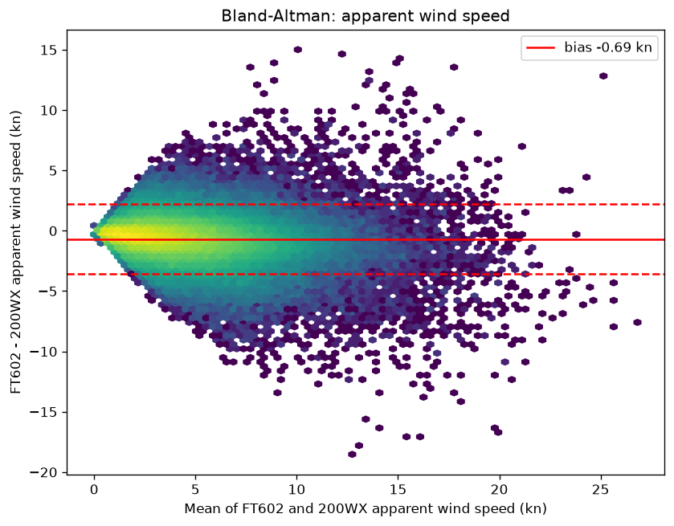
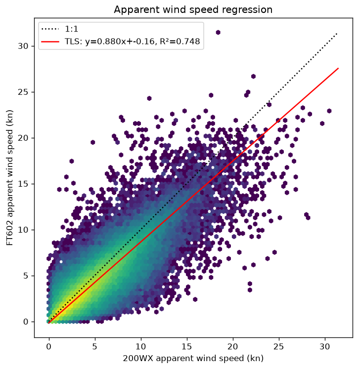
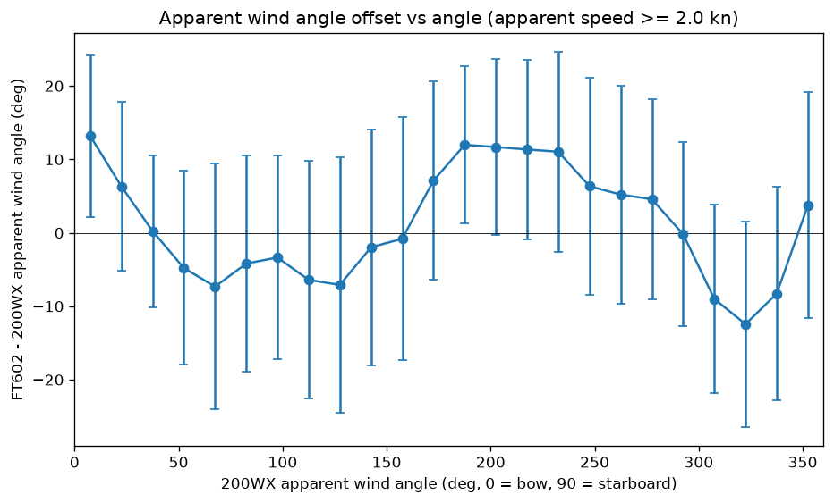
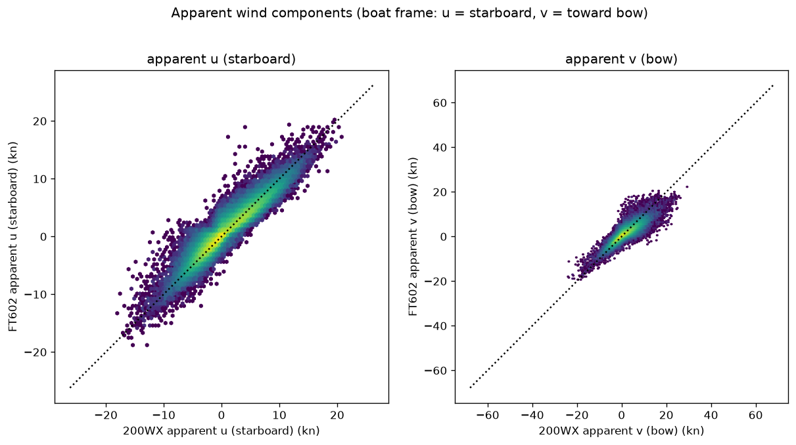
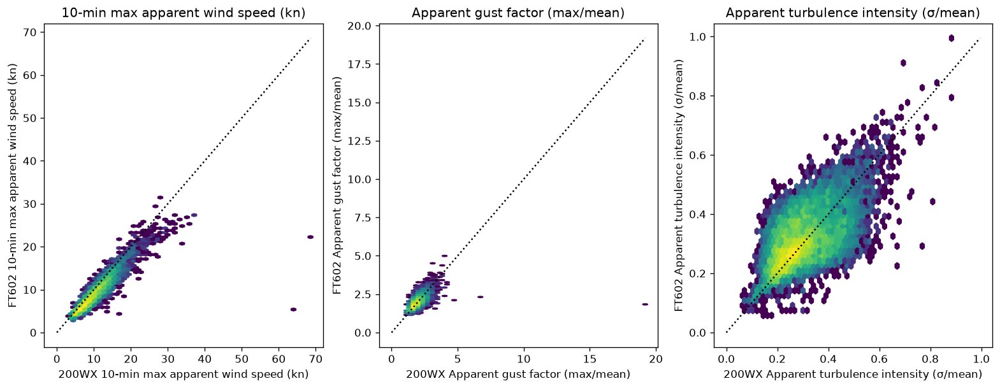

# FT602 vs Airmar 200WX: wind comparison

This report compares an FT602 (NMEA talker `FT`) with an Airmar 200WX (talker `WI`) over four months. The FT602 was mounted on the starboard side of the Western Flyer, the Airmar on the port side, about 5 meters away. Both sensors sit well above the deck. The stack is located on the centerline, about 5 meters to aft. This means the FT602 would be in its wind shadow for apparent wind angles of 135°, the 200WX for angles of 225°. Otherwise, both sensors have uninterrupted airflow. 

The vast majority of the time, the vessel was berthed at its dock, which is oriented north-south, bow pointing south.  

Throughout, differences are **FT602 − 200WX**. The wind is *apparent* wind, so directions are relative to the boat's bow and not to north.

### 1. Data

|                    | FT602                               | 200WX                      |
|--------------------|-------------------------------------|----------------------------|
| Period (UTC)       | 2026-08-08 22:41 → 2026-11-27 20:52 | same                       |
| Raw samples        | 19.1 M (about 2 per second)         | 9.5 M (about 1 per second) |
| 1 s bins with data | 9.57 M                              | 9.47 M                     |

- Both instruments run for about 111 days. Almost every second has data from both, which gives **9.57 M matched pairs**.
- Each instrument is averaged to 1 s bins. Direction is averaged as *vectors*, so 359° and 1° average to 0°, not 180°. The two series are then paired with a 1 s tolerance.
- The FT602 reports about twice as often as the 200WX. This is one reason the two units can differ on peaks (section 4).

### 2. Wind speed

| Subset                 | n      | Bias (kn) | SD of diff (kn) | RMSE (kn) | Slope | Intercept (kn) | R²    |
|------------------------|--------|-----------|-----------------|-----------|-------|----------------|-------|
| All                    | 9.57 M | −0.69     | 1.49            | 1.64      | 0.881 | −0.16          | 0.745 |
| Low wind (mean < 2 kn) | 2.20 M | −0.32     | 0.72            | 0.79      | 0.688 | 0.12           | 0.076 |
| Higher wind (≥ 2 kn)   | 7.38 M | −0.79     | 1.64            | 1.82      | 0.883 | −0.17          | 0.657 |

Slope, intercept and R² come from an orthogonal (total least squares) fit of FT602 on 200WX.

**Bland-Altman plot.** The x-axis is the mean of the two speeds and the y-axis is their difference. The solid red line is the mean bias (−0.69 kn). The dashed lines are bias ± 1.96 SD. Colour shows how many points fall in each hexagon, on a log scale.

- The FT602 reads lower than the 200WX on average.
- The cloud is centred below zero and the bias does not shrink at higher speeds. This points to a **scale difference**, not just an offset.
- The spread widens with wind speed. Some of this is real turbulence seen slightly differently by each sensor. 
- A few extreme points (±10–18 kn) are rare outliers. They are likely single-sample glitches or timing skew during strong gusts.

**Regression.** The black dotted line is 1:1 and the red line is the fit. A slope of 0.88 means the FT602 reads about **12 % lower** than the 200WX across the range. The intercept is small, so there is no large zero-wind offset. R² = 0.75 is moderate, probably because the 1 s data are noisy.

**Low wind.** In calm conditions the absolute bias is smaller (−0.3 kn), but the two instruments agree poorly in relative terms (R² = 0.08, slope 0.69). At these speeds the signal is smaller than the noise floor of each sensor. 

### 3. Wind direction

Only samples where **both** instruments read ≥ 2 kn are used (6.53 M pairs). Direction is meaningless near calm.

- Circular mean offset: **−2.7°**
- Circular SD of the offset: **15.8°**

The overall offset is small, but the plot shows it is **not constant**. It depends on the wind direction: the dots are the mean offset in 15° bins of the 200WX direction, and the bars are ±1 circular SD.

- At about 0–10° the FT602 reads about 10–13° higher than the 200WX. It then falls to a minimum of about −7° near 70–130° and recovers to about +12° near 190–230°.
- It dips again to about −12° near 320° and rises back to about +4° at 350°.

A fixed misalignment would shift every bin by the same amount. Instead the offset swings by about ±12° around the mean, which looks like a **direction-dependent distortion**. Likely causes are:

- the two sensors are located on opposite sides of the boat, which can cause a direction-dependent distortion,
- non-linear responses of one or both sensors;
- a small heading mismatch combined with these effects.

This analysis cannot tell which sensor is correct, only that they disagree in a direction-dependent way. The within-bin scatter (SD of about 11–17°) is large because the data are 1 s values in gusty, turbulent air.

**Components.** These are apparent-wind components in the boat's frame: u is the starboard component (90° = starboard) and v is the bow component (0° = bow), not east/north.

| Component | Bias (kn) | Slope | R²    |
|-----------|-----------|-------|-------|
| u         | +0.08     | 0.928 | 0.906 |
| v         | −0.31     | 0.750 | 0.780 |

- The two components differ in slope. The v component agrees worse than u: the FT602 reads about 25 % lower in v and about 7 % lower in u.
- Because the two components scale differently, the speed deficit is not a uniform gain error. It depends on the wind direction, which is consistent with the direction-dependent offset above. This suggests the difference is mostly **geometric (flow distortion or installation)** and not purely calibration.
- These u/v statistics use all samples, including calm, so low-wind noise slightly lowers R².

### 4. Gusts and turbulence

The data are split into 10-minute windows. Windows with less than 80 % coverage, or a mean speed below 2 kn for either instrument, are dropped. That leaves **12,022 windows**.

| Metric                        | FT602 mean | 200WX mean | FT/WX ratio | Slope | R²    |
|-------------------------------|------------|------------|-------------|-------|-------|
| Gust (10-min max, kn)         | 8.44       | 9.76       | 0.865       | 0.886 | 0.871 |
| Gust factor (max/mean)        | 1.915      | 1.904      | 1.006       | 0.763 | 0.436 |
| Turbulence intensity (σ/mean) | 0.317      | 0.309      | 1.027       | 0.851 | 0.373 |

- **Gust speed:** the FT602 peaks are about 13 % lower than the 200WX. This is almost the same as the steady-speed ratio (0.88), and the correlation is high (R² = 0.87).
- **Gust factor and turbulence intensity:** these are ratios, so a pure scale error cancels. The means agree within 1–3 %, which means the two instruments see **essentially the same gustiness**. The FT602's higher reporting rate and any internal filtering do not noticeably change the statistics at 1 s resolution.
- The R² values of 0.4 for the gust factor and 0.37 for turbulence intensity are low. Window-to-window values of these ratios are noisy, so they only agree on average, not window by window.

### 5. Conclusions

1. **Speed:** the FT602 reads about 0.7 kn (about 12 %) lower than the 200WX, with essentially no zero offset. This is a scale difference.
2. **Direction:** the mean offset is small (−2.7°), but the offset varies by about ±12° with wind direction. This is the signature of flow distortion or mounting effects. It is not a simple alignment error.
3. **Components:** the v component disagrees more than u. This again points to direction-dependent effects and not a uniform gain.
4. **Gusts and turbulence:** the gust factor and turbulence intensity are nearly identical for the two instruments. Peak gusts differ by the same ~12 % as the mean speed.
5. **Low wind:** below 2 kn the instruments mostly disagree because of noise, so do not use these data for fine comparisons.

### 6. Limitations

- Only 1 Hz NMEA data are available, so power spectra and high-frequency roll-off cannot be assessed.
- There is no ground truth. The analysis shows how the two instruments differ, not which one is right.
- Apparent wind includes the boat's motion and heading changes. Some direction scatter may come from the boat turning, which affects both sensors only if they sit at different positions.
